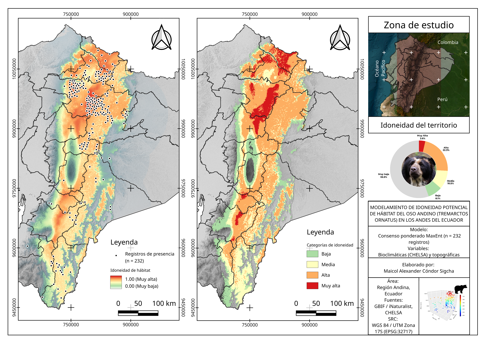

# Modelamiento de Idoneidad Potencial de Hábitat de *Tremarctos ornatus* en los Andes del Ecuador

Proyecto de modelamiento espacial de nicho ecológico (SDM) para evaluar la distribución potencial del oso andino (*Tremarctos ornatus*) en la región Andina del Ecuador mediante ensamblaje ponderado en **MaxEnt**, análisis topográfico-climático en **R** y composición cartográfica en **QGIS**.

## Resumen de Resultados
* **Registros de presencia depurados:** n = 232 ocurrencias (GBIF / iNaturalist).
* **Sistema de Referencia de Coordenadas:** WGS 84 / UTM Zona 17S (`EPSG:32717`).
* **Distribución porcentual de idoneidad en el área de estudio:**
  * **Muy alta:** 3.6 %
  * **Alta:** 22.3 %
  * **Media:** 10.5 %
  * **Baja:** 8.1 %
  * **Muy baja:** 55.5 %

## Flujo Metodológico
1. **Depuración espacial y ambiental (`R`):** Filtrado de ocurrencias, selección de variables bioclimáticas (**CHELSA**) y topográficas (**DEM SRTM 30s**, pendiente, TPI) mediante análisis de multicolinealidad (VIF).
2. **Modelamiento de distribución (`MaxEnt` / `R`):** Generación y calibración de modelos candidatos y obtención de un modelo de consenso ponderado.
3. **Visualización 3D y estadística (`R` / `Canva`):** Análisis altitudinal en espacio tridimensional (`plot3D`) y cuantificación superficial por clases de idoneidad.
4. **Composición cartográfica (`QGIS`):** Diseño de lámina comparativa de doble panel (idoneidad continua vs. categorizada) con mapa de ubicación, métricas territoriales y gráfico 3D integrado.

## Estructura del Repositorio
* `scripts/`: Código fuente en R para preparación de variables, modelamiento y gráfico 3D.
* `datos/`: Matriz depurada de registros de presencia con coordenadas UTM y altitud (`puntos_oso_3d.csv`).
* `qgis/`: Plantilla cartográfica reutilizable de doble panel (`Plantilla_Idoneidad_2Paneles.qpt`).
* `resultados/`: Lámina cartográfica final en PDF y PNG (300 dpi).

## Autor
**Maicol Alexander Cóndor Sigcha**  
*Modelamiento Espacial • SIG • Ecología Cuantitativa*
